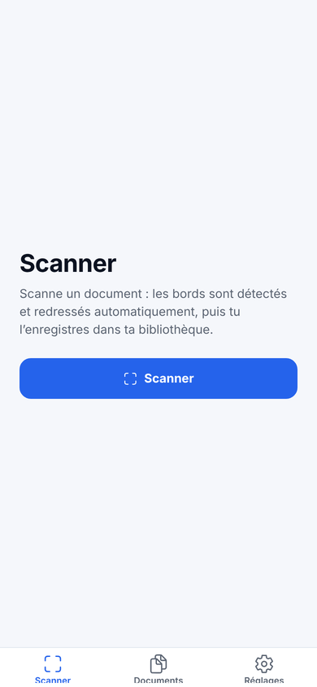
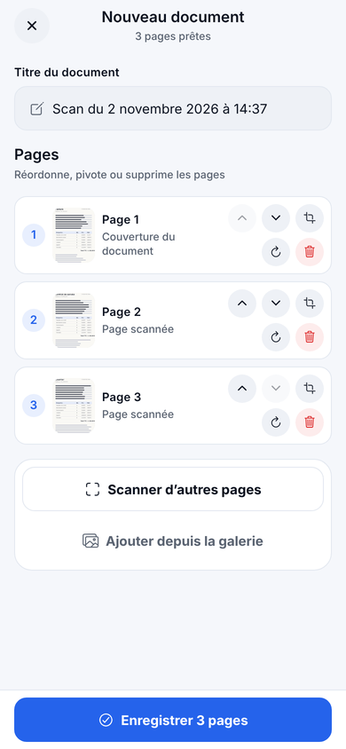
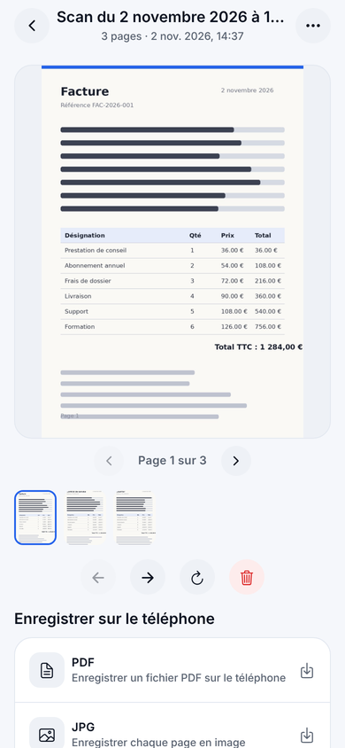
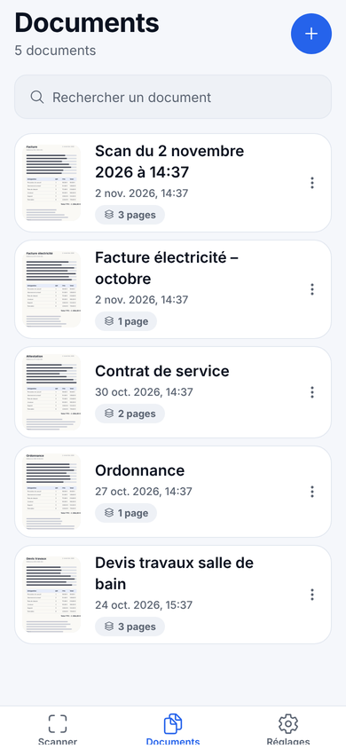
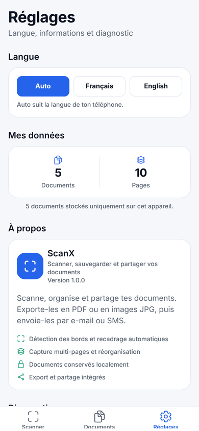
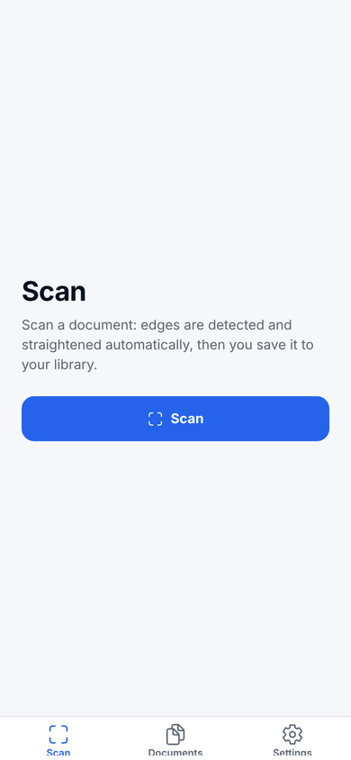
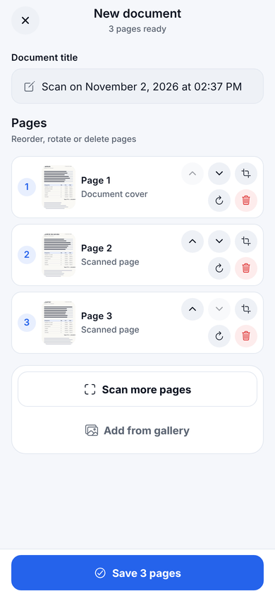
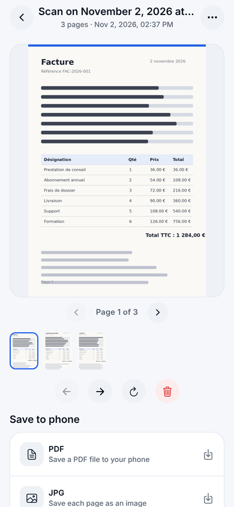
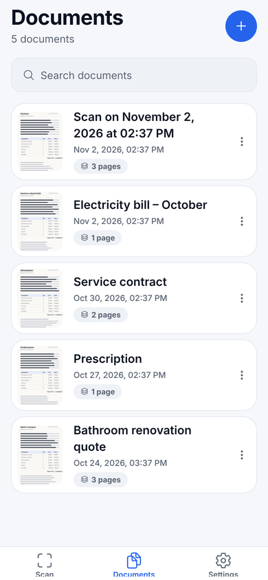
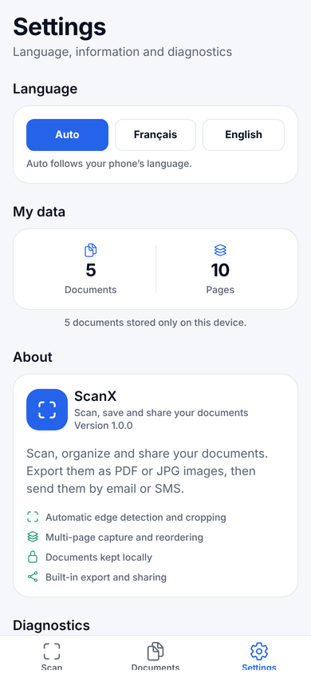

  

<h1 align="center">ScanX</h1>

<strong>Scanner, sauvegarder et partager vos documents</strong> 
<em>Scan, save and share your documents</em>

  <a href="https://github.com/karimbel/scanX-showcase/releases/latest"><b>Télécharger l'APK / Download the APK</b></a>
  ·
  <a href="https://karimbel.github.io/scanX-showcase/">Site web / Website</a>

---

## Français

ScanX est une application Android pour numériser vos documents papier avec le téléphone, les enregistrer en PDF ou JPG et les partager.

| Scanner | Vérification | Document | Bibliothèque | Réglages |
| :---: | :---: | :---: | :---: | :---: |
|  |  |  |  |  |

### Fonctionnalités

- **Détection automatique** des bords, redressement et recadrage, avec le scanner de Google (ML Kit).
- **Multi-pages** : ajout, réorganisation, rotation, recadrage et suppression des pages.
- **PDF ou JPG** : enregistrement dans le dossier de votre choix, partage par e-mail ou SMS.
- **Vos documents restent sur votre téléphone** : aucun compte, aucun envoi vers un serveur.
- **Français et anglais** : la langue suit celle du téléphone, avec un choix manuel dans Réglages.
- **Bibliothèque** avec recherche et renommage.

### Installation

1. Sur votre téléphone Android, ouvrez la [dernière version](https://github.com/karimbel/scanX-showcase/releases/latest) et téléchargez le fichier `.apk`.
2. Ouvrez le fichier. Si Android le demande, autorisez l'installation d'applications depuis cette source.
3. Lancez ScanX.

Pour mettre à jour, téléchargez la dernière version et installez-la par-dessus l'ancienne : vos documents sont conservés.

> ScanX est distribuée hors Google Play. Le scanner utilise les services Google Play de l'appareil.

---

## English

ScanX is an Android app that digitizes paper documents with your phone, saves them as PDF or JPG and lets you share them.

| Scan | Review | Document | Library | Settings |
| :---: | :---: | :---: | :---: | :---: |
|  |  |  |  |  |

### Features

- **Automatic detection** of edges, straightening and cropping, using Google's scanner (ML Kit).
- **Multi-page**: add, reorder, rotate, crop and delete pages.
- **PDF or JPG**: save to the folder of your choice, share by email or SMS.
- **Your documents stay on your phone**: no account, nothing sent to a server.
- **French and English**: the language follows your phone, with a manual choice in Settings.
- **Library** with search and rename.

### Installation

1. On your Android phone, open the [latest release](https://github.com/karimbel/scanX-showcase/releases/latest) and download the `.apk` file.
2. Open the file. If Android asks, allow installing apps from this source.
3. Launch ScanX.

To update, download the latest version and install it over the old one: your documents are kept.

> ScanX is distributed outside Google Play. The scanner relies on the device's Google Play services.

---

Ce dépôt est la vitrine publique de ScanX : présentation et téléchargements. This repository is ScanX's public showcase: overview and downloads.
